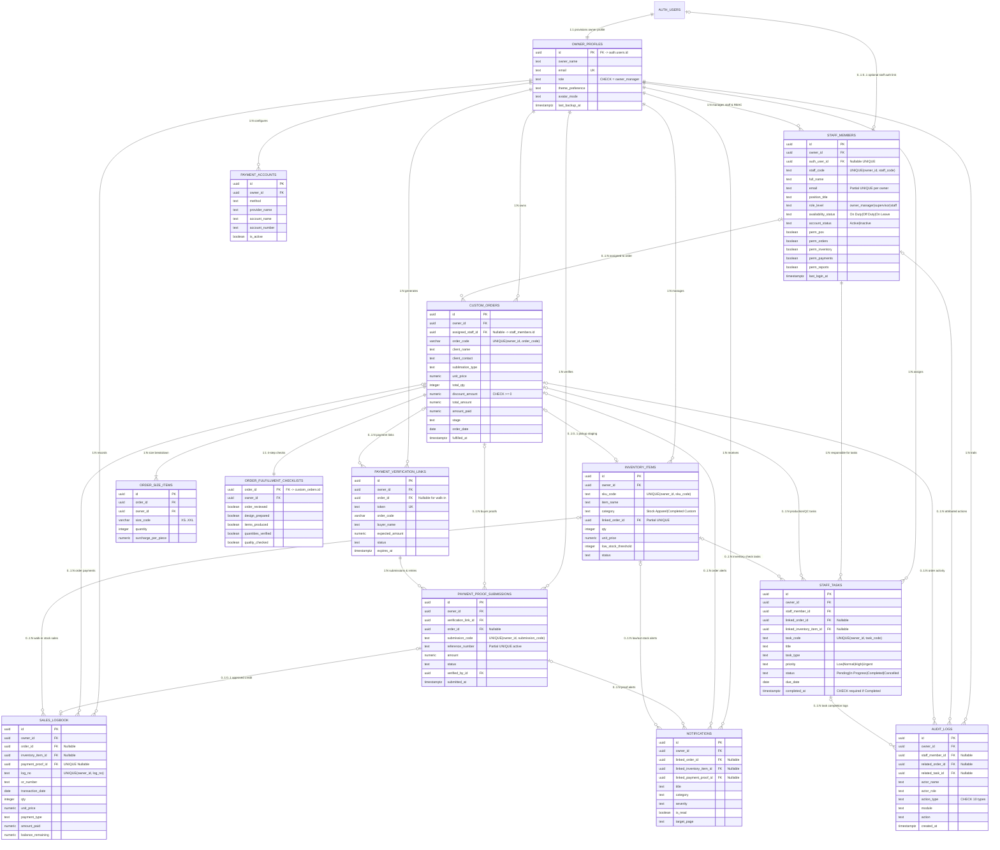

# JM Maker Sportswear — Supabase PostgreSQL Database Documentation

This document describes the complete normalized **Supabase PostgreSQL** database schema (`13` normalized tables, `2` security-invoker reporting views, `6` transactional RPC functions, and `4` non-destructive SQL migrations), primary/foreign key relations, Row Level Security (RLS) policies, indexes, and frontend integration for the **Point of Sale and Inventory System with Staff Monitoring and Analytics for JM Maker Sportswear**.

---

## 1. Design Rationale & Architecture Principles

1. **Owner-Scoped Multi-Module Isolation (`owner_profiles`)**: Every operational table references `owner_id -> owner_profiles(id) ON DELETE CASCADE` so Row Level Security enforces strict tenant/store isolation (`owner_id = auth.uid()`) in O(1) indexed lookups.
2. **True Relational Normalization (1NF–3NF) Without Redundancy**:
   - **`order_size_items` (`1:N` from `custom_orders`)**: Normalizes the 6-size breakdown (`XS`–`XXL`) and the ₱50 `XXL+` surcharge out of repeating columns/JSON into structured rows constrained by `UNIQUE (order_id, size_code)`.
   - **`order_fulfillment_checklists` (`1:1` with `custom_orders`)**: Separates the 4-step fulfillment verification flags from core POS order attributes (`order_id` is both PK and FK).
   - **`staff_members` (`1:N` from `owner_profiles`) & `staff_tasks` (`1:N` from `staff_members`)**: Added in Migration `004` to satisfy Capstone Objective 4 (Staff Monitoring, RBAC permissions, shift/availability tracking, and operational task completion linked optionally to `custom_orders` or `inventory_items`).
   - **No circular foreign keys**: `payment_proof_submissions.verification_link_id -> payment_verification_links(id)` models the exact `1:N` retry flow (when an owner rejects a blurry receipt, the link reactivates so the buyer can submit a clearer proof).
   - **No duplicate summary tables**: Monthly sales metrics and staff task performance metrics are computed dynamically via `v_monthly_sales_summary` and `v_staff_performance_summary`, both defined `WITH (security_invoker = true)` so RLS applies automatically.
   - **Why no many-to-many junction table is included**: Every domain relationship in JM Maker Sportswear's workflow is strictly `1:1`, `1:N`, or `0..1:N` (each custom order uses one apparel package with normalized size rows; each walk-in sale deducts one finished-goods product; each operational staff task has one responsible staff owner). If multi-item shopping carts or multi-staff co-assignments are added in a future phase, `sales_logbook_items` or `staff_task_assignees` junction tables can be introduced non-destructively.
3. **Immutable Append-Only Audit Trail (`audit_logs`)**: Authenticated users hold `SELECT` and `INSERT` privileges only — `UPDATE` and `DELETE` are explicitly revoked so logged logins, order updates, task completions, stock edits, and price changes cannot be altered or erased.
4. **Zero Service-Role Key Exposure**: The browser client (`src/lib/supabaseClient.ts`) uses ONLY `VITE_SUPABASE_ANON_KEY`. Anonymous buyers on `buyer.html?token=...` have **zero direct table privileges** and interact exclusively through two token-scoped `SECURITY DEFINER` PostgreSQL RPCs (`resolve_payment_verification_link` and `submit_tokenized_payment_proof`).

---

## 2. Entity-Relationship Diagram (Mermaid ERD — 13 Tables)

---

## 3. Table-by-Table Breakdown (All 13 Tables + 2 Views)

| # | Table / View Name | Purpose | Primary Key | Key Foreign Keys & Constraints |
| --- | --- | --- | --- | --- |
| 1 | `owner_profiles` | Store owner identity, theme, avatar configuration, and last backup timestamp | `id` (`uuid`, FK `auth.users.id`) | `UNIQUE(email)`, `CHECK(role = 'owner_manager')` |
| 2 | `staff_members` | Shop personnel directory, schedules, availability, RBAC module permissions, and login tracking | `id` (`uuid`) | `owner_id -> owner_profiles`, `auth_user_id -> auth.users`, `UNIQUE(owner_id, staff_code)`, partial `UNIQUE(owner_id, lower(email))` |
| 3 | `custom_orders` | Custom jersey order header, customer contact, package pricing, discounts, stage, and payments | `id` (`uuid`) | `owner_id -> owner_profiles`, `assigned_staff_id -> staff_members`, `UNIQUE(owner_id, order_code)`, `CHECK(discount_amount >= 0)`, `CHECK(amount_paid <= total_amount)` |
| 4 | `order_size_items` | Normalized 6-size quantities (`XS`–`XXL`) and ₱50 `XXL` surcharge | `id` (`uuid`) | `order_id -> custom_orders (CASCADE)`, `owner_id -> owner_profiles`, `UNIQUE(order_id, size_code)` |
| 5 | `order_fulfillment_checklists` | 4-step fulfillment gate flags (Review, Design, Production, Quantity, Quality) | `order_id` (`uuid`, PK+FK) | `order_id -> custom_orders (CASCADE)`, `owner_id -> owner_profiles` |
| 6 | `inventory_items` | Finished-goods ready stock (`Stock Apparel`) and pickup staging (`Completed Custom`) | `id` (`uuid`) | `owner_id -> owner_profiles`, `linked_order_id -> custom_orders (CASCADE)`, `UNIQUE(owner_id, sku_code)`, partial `UNIQUE(linked_order_id)` for `Completed Custom` |
| 7 | `staff_tasks` | Operational task assignments linked to staff, custom orders, or inventory items | `id` (`uuid`) | `owner_id -> owner_profiles`, `staff_member_id -> staff_members (CASCADE)`, `linked_order_id -> custom_orders`, `linked_inventory_item_id -> inventory_items`, `CHECK(status <> 'Completed' OR completed_at IS NOT NULL)` |
| 8 | `payment_accounts` | Official store GCash, Bank Transfer, and Maya receiving accounts | `id` (`uuid`) | `owner_id -> owner_profiles`, `UNIQUE(owner_id, method, account_number)` |
| 9 | `payment_verification_links` | Token-gated buyer payment upload links (`jm_...`) with expiry and status lifecycle | `id` (`uuid`) | `owner_id -> owner_profiles`, `order_id -> custom_orders (SET NULL)`, `UNIQUE(token)` |
| 10 | `payment_proof_submissions` | Buyer receipt uploads, normalized reference numbers, and owner approval/rejection metadata | `id` (`uuid`) | `verification_link_id -> payment_verification_links (RESTRICT)`, `order_id -> custom_orders`, `verified_by_id -> owner_profiles`, partial `UNIQUE(owner_id, upper(reference_number))` for non-rejected proofs |
| 11 | `sales_logbook` | Master financial transaction ledger for custom order payments and walk-in stock sales | `id` (`uuid`) | `owner_id -> owner_profiles`, `order_id -> custom_orders`, `inventory_item_id -> inventory_items`, `payment_proof_id -> payment_proof_submissions (UNIQUE)`, `UNIQUE(owner_id, log_no)` |
| 12 | `notifications` | Real-time alerts for low/out stock, order ready-for-release, buyer proofs, staff tasks, and backups | `id` (`uuid`) | `owner_id -> owner_profiles`, `linked_order_id`, `linked_inventory_item_id`, `linked_payment_proof_id`, `CHECK(target_page IN (...9 pages including 'staff-monitoring'))` |
| 13 | `audit_logs` | Strictly append-only, actor-attributed audit trail of logins, order updates, tasks, price/stock edits | `id` (`uuid`) | `owner_id -> owner_profiles`, `staff_member_id -> staff_members`, `related_order_id -> custom_orders`, `related_task_id -> staff_tasks`, `CHECK(action_type IN (10 types))`, NO `UPDATE`/`DELETE` grants |
| V1 | `v_monthly_sales_summary` | Dynamic monthly revenue, custom vs. stock revenue, and unit totals (`security_invoker = true`) | View | Reads `sales_logbook` with caller RLS enforcement |
| V2 | `v_staff_performance_summary` | Dynamic per-staff task completion rates and logged activity counts (`security_invoker = true`) | View | Joins `staff_members`, `staff_tasks`, and `audit_logs` with caller RLS enforcement |

---

## 4. Relationship Summary & Cardinalities

| Parent Table | Child Table | Cardinality | Foreign Key & `ON DELETE` Rule | Purpose |
| --- | --- | --- | --- | --- |
| `auth.users` | `owner_profiles` | **1 : 1** | `owner_profiles.id -> auth.users(id)` (`CASCADE`) | Extends Supabase Auth user with store owner profile, avatar & theme |
| `auth.users` | `staff_members` | **0..1 : 0..1** | `staff_members.auth_user_id -> auth.users(id)` (`SET NULL`) | Optional link if a staff account is later provisioned in Supabase Auth |
| `owner_profiles` | All 12 domain tables | **1 : N** | `<table>.owner_id -> owner_profiles(id)` (`CASCADE`) | Store ownership & indexed RLS isolation (`owner_id = auth.uid()`) |
| `staff_members` | `custom_orders` | **0..1 : N** | `custom_orders.assigned_staff_id -> staff_members(id)` (`SET NULL`) | Tracks which staff member is responsible for producing/handling an order |
| `staff_members` | `staff_tasks` | **1 : N** | `staff_tasks.staff_member_id -> staff_members(id)` (`CASCADE`) | Assigns operational production, QC, release, or stock tasks to staff |
| `staff_members` | `audit_logs` | **0..1 : N** | `audit_logs.staff_member_id -> staff_members(id)` (`SET NULL`) | Attributes logins, status updates, and edits to specific staff members |
| `custom_orders` | `order_size_items` | **1 : N** | `order_size_items.order_id -> custom_orders(id)` (`CASCADE`) | Normalized jersey quantities per size (`XS`–`XXL`) + surcharge |
| `custom_orders` | `order_fulfillment_checklists` | **1 : 1** | `order_fulfillment_checklists.order_id -> custom_orders(id)` (`CASCADE`) | 4-step fulfillment review, production & inspection checklist |
| `custom_orders` | `inventory_items` | **0..1 : 0..1** | `inventory_items.linked_order_id -> custom_orders(id)` (`CASCADE`) | Temporary pickup staging row (`Completed Custom`) during Steps 3–4 |
| `custom_orders` | `staff_tasks` | **0..1 : N** | `staff_tasks.linked_order_id -> custom_orders(id)` (`SET NULL`) | Links shop tasks directly to active custom orders |
| `inventory_items` | `staff_tasks` | **0..1 : N** | `staff_tasks.linked_inventory_item_id -> inventory_items(id)` (`SET NULL`) | Links inventory count/restock tasks to stock products |
| `custom_orders` | `payment_verification_links` | **0..1 : N** | `payment_verification_links.order_id -> custom_orders(id)` (`SET NULL`) | Payment upload links per custom order (or `NULL` for walk-in links) |
| `payment_verification_links` | `payment_proof_submissions` | **1 : N** | `payment_proof_submissions.verification_link_id -> payment_verification_links(id)` (`RESTRICT`) | Preserves rejected + resubmitted buyer proofs on the same link |
| `custom_orders` | `payment_proof_submissions` | **0..1 : N** | `payment_proof_submissions.order_id -> custom_orders(id)` (`SET NULL`) | Ties verified proofs directly to the custom order |
| `owner_profiles` | `payment_proof_submissions` | **0..1 : N** | `payment_proof_submissions.verified_by_id -> owner_profiles(id)` (`SET NULL`) | Audits which owner verified the submission |
| `custom_orders` | `sales_logbook` | **0..1 : N** | `sales_logbook.order_id -> custom_orders(id)` (`SET NULL`) | Tracks downpayments, approved proofs & balance settlements |
| `inventory_items` | `sales_logbook` | **0..1 : N** | `sales_logbook.inventory_item_id -> inventory_items(id)` (`SET NULL`) | Tracks walk-in stock sales by finished-goods item |
| `payment_proof_submissions` | `sales_logbook` | **0..1 : 0..1** | `sales_logbook.payment_proof_id -> payment_proof_submissions(id)` (`SET NULL`, `UNIQUE`) | Guarantees an approved proof can never be double-credited |
| `custom_orders` / `inventory_items` / `payment_proof_submissions` | `notifications` | **0..1 : N** | `linked_order_id`, `linked_inventory_item_id`, `linked_payment_proof_id` (`SET NULL`) | Deep-links alerts straight to the affected order, stock item, or proof |
| `custom_orders` / `staff_tasks` | `audit_logs` | **0..1 : N** | `related_order_id`, `related_task_id` (`SET NULL`) | Retains immutable audit history even if operational rows are later removed |

---

## 5. Transactional PostgreSQL RPC Functions

| Function | Role Access | Atomic Behavior |
| --- | --- | --- |
| `resolve_payment_verification_link(p_token)` | `anon`, `authenticated` | Validates opaque buyer token, checks expiry/revocation, and returns scoped order summary without exposing tables. |
| `submit_tokenized_payment_proof(...)` | `anon`, `authenticated` | Normalizes reference code, blocks duplicates & pending resubmissions, inserts proof, updates link status, and notifies owner. |
| `approve_payment_proof(p_submission_id)` | `authenticated` | Locks submission & order, prevents double-approval, updates `amount_paid`, logs `sales_logbook`, marks link `Verified`, and writes `audit_logs`. |
| `reject_payment_proof(p_submission_id, p_reason)` | `authenticated` | Requires meaningful reason (`>= 5` chars), marks proof `Rejected`, re-activates the buyer's link for resubmission, and writes `audit_logs`. |
| `record_walk_in_stock_sale(...)` | `authenticated` | Locks `inventory_items`, prevents overselling, deducts quantity, recalculates stock status, fires Low/Out-of-Stock alert, and logs `sales_logbook`. |
| `reset_owner_store_data()` | `authenticated` | Deletes all operational tables for `auth.uid()` in strict FK-safe order (`notifications -> audit_logs -> sales_logbook -> payment_proof_submissions -> payment_verification_links -> payment_accounts -> staff_tasks -> inventory_items -> custom_orders -> staff_members`). |

---

## 6. SQL Migrations & Supabase Deployment Steps

1. Create a Supabase project at https://supabase.com.
2. Apply all **four** SQL migrations in strict chronological order (via Supabase CLI `supabase db push` or **Supabase Dashboard → SQL Editor**):
   - [`supabase/migrations/202611260001_initial_schema.sql`](../supabase/migrations/202611260001_initial_schema.sql)
   - [`supabase/migrations/202611260002_indexes_and_rls.sql`](../supabase/migrations/202611260002_indexes_and_rls.sql)
   - [`supabase/migrations/202611260003_functions_and_rpcs.sql`](../supabase/migrations/202611260003_functions_and_rpcs.sql)
   - [`supabase/migrations/202611280004_staff_monitoring_and_pos_enhancements.sql`](../supabase/migrations/202611280004_staff_monitoring_and_pos_enhancements.sql)
3. Copy `.env.example` to `.env.local` and paste your **Project URL** and **anon public key** from **Supabase Dashboard → Project Settings → API**.
4. In **Supabase Dashboard → Database → Replication**, enable Realtime on `payment_proof_submissions` and `notifications` so buyer submissions stream live onto the Owner dashboard.
5. Run `npm install` and `npm run dev` — the application automatically transitions from local fallback mode to full Supabase PostgreSQL + Supabase Auth + Realtime mode.
