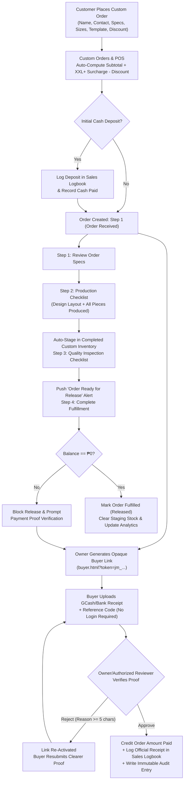
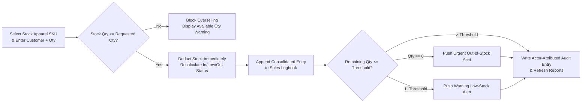
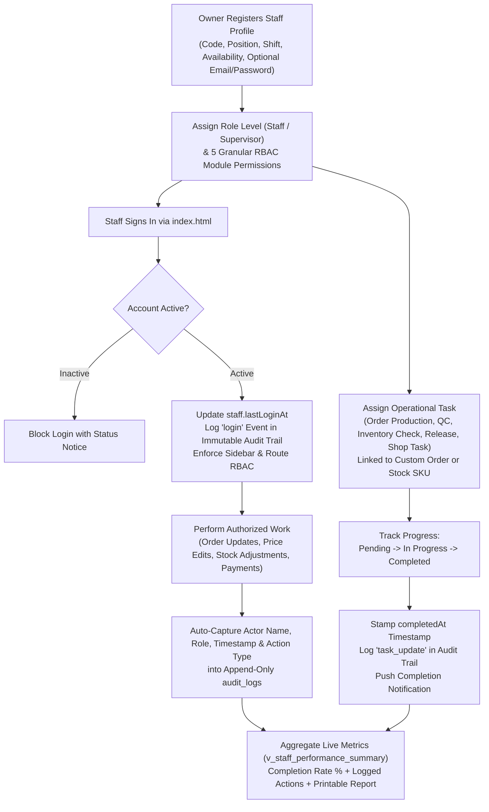
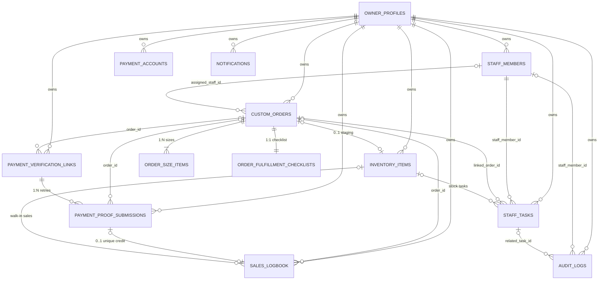

# POINT OF SALE AND INVENTORY SYSTEM WITH STAFF MONITORING AND ANALYTICS FOR JM MAKER SPORTSWEAR

**Formal System Implementation Explanation, Compliance Matrix, Database Architecture, Testing Report & Production-Readiness Paper**

| Metadata | Details |
| --- | --- |
| **Institution** | STI College Fairview — Information and Communications Technology Program (BSIT) |
| **Proponents** | Joshua N. Orsal, Almira Jane P. Sale, Rinoa Leigh P. Sampana, Marc Lenn Franz M. Villaluz |
| **Client Business** | JM Maker Sportswear (Cabuyao, Laguna, Philippines) |
| **Document Version** | Final Implementation & Verification Edition (November 2026) |
| **Repository** | `jm-sportswear` (GitHub: `franzxcITboi/jm-sportswear`) |

---

## 1. Introduction and Business Context

**JM Maker Sportswear** is a customized jersey manufacturing and sublimation printing business located in Cabuyao, Laguna, serving individual customers, sports teams, educational institutions, and corporate organizations. Prior to digitization, the business relied on manual paper logbooks to record customer specifications (design, size breakdowns, colorways, printing options), compute custom order totals, track partial downpayments and GCash reference codes, monitor finished-goods stock levels, track order production progress, and review sales performance.

Structured owner interviews (Appendix A, Questions 1–25 of the Capstone Proposal) identified six concrete operational bottlenecks:

1. **Fragmented Order Records (Q1–Q5)**: Difficulty organizing and updating customized jersey details (customer name, contact information, design templates, sizes `XS`–`XXL+`, colorway, and printing specifications) when clients request mid-order revisions.
2. **Error-Prone Manual Pricing & Payment Tracking (Q6–Q10)**: Manual calculation of totals, XXL+ surcharges, discounts, downpayments, remaining balances, and manual verification of GCash/Bank payment reference codes.
3. **Delayed Stock Synchronization (Q11–Q13)**: Finished goods and ready-to-sell apparel stock counts falling out of sync after walk-in sales or completed custom order releases (while explicitly keeping raw materials such as fabric rolls, thread, and ink out of scope).
4. **Lack of Order Stage Visibility (Q14–Q16)**: Uncertainty regarding which orders are newly received, in production, undergoing quality inspection, or ready for customer release.
5. **Missing Staff Activity & Accountability Logs (Q17–Q18)**: No centralized record of *who* logged in, updated an order status, completed an operational task, or modified product prices and stock quantities, nor role-based limits on module access.
6. **Manual Sales Consolidation & Delayed Alerts (Q19–Q21)**: No automated alerts for low/out-of-stock products or orders ready for release, and no instant daily, weekly, monthly, or annual analytics charts and exportable summaries.

This paper documents the **actual implemented and verified system** built to address each of those operational requirements.

---

## 2. System Objectives & Objective-to-Feature Compliance Matrix

### General Objective
Design and develop a centralized **Point of Sale and Inventory System with Staff Monitoring and Analytics for JM Maker Sportswear** that automates sales transaction processing, custom jersey specifications, payment verification, finished-goods inventory tracking, staff accountability monitoring, automated alerts, and visual business analytics.

### Objective-to-Feature Compliance Matrix

| Paper Objective / Interview Req. | Implemented Module & Source Files | Database Backing (Supabase PostgreSQL) | Implementation Status | Verification & Test Evidence |
| --- | --- | --- | --- | --- |
| **SO 1 — Point-of-Sale (POS) Module** (record transactions, compute totals + XXL+ surcharge, **apply discounts**, log partial/full payments, customer contact info [Q4], printable receipts) | **Custom Orders & POS** (`src/modules/posSpecsModule.ts`, `src/utils/calculations.ts`) & **Sales History** (`src/modules/salesLogbookModule.ts`) | `custom_orders` (`client_contact`, `discount_amount`, `unit_price`, `total_amount`, `amount_paid`), `order_size_items`, `sales_logbook` | **Completed** | `qa_full_e2e_test.mjs` Stage 3 (PASS); live discount clamping & invoice print verified; `tsc --noEmit` PASS |
| **SO 2 — Order Management & Tracking** (custom jersey specs, jersey template upload, sequential 4-stage pipeline: *Order Received → Production → Quality Inspection → Ready for Release → Fulfilled*) | **Order Fulfillment** (`src/modules/fulfillment/fulfillmentModule.ts`, `fulfillmentStepsView.ts`) & **Custom Orders & POS** | `custom_orders`, `order_size_items`, `order_fulfillment_checklists` (`1:1`), `inventory_items` (`Completed Custom` staging) | **Completed** | `qa_full_e2e_test.mjs` Stage 4 & Stage 4 Final (PASS); checklist gating & unpaid balance block verified |
| **SO 3 — Simplified Finished Goods Inventory** (ready-to-sell apparel + completed orders only, real-time deduction on sale/release, low/out-of-stock notifications; NO raw materials) | **Finished Goods Inventory** (`src/modules/inventoryModule.ts`) & **Notifications** (`src/modules/notificationsModule.ts`) | `inventory_items` (`category CHECK ('Stock Apparel', 'Completed Custom')`), `notifications`, `record_walk_in_stock_sale()` RPC | **Completed** | `verify_supabase_db.mjs` (oversell guard + low-stock trigger PASS); `qa_full_e2e_test.mjs` Stage 3 (PASS) |
| **SO 4 — Staff Monitoring Module** (staff profiles/schedules/availability, RBAC module permissions, task assignments & completion tracking, immutable activity & login audit trail [Q17–Q18]) | **Staff Monitoring & Accountability** (`src/modules/staff/staffMonitoringModule.ts`, `staffMonitoringMetrics.ts`), **Auth RBAC** (`src/services/authService.ts`), **Login/Logout Audit** (`loginController.ts`, `dashboardController.ts`) | `staff_members` (5 RBAC flags), `staff_tasks`, `audit_logs` (append-only, `actor_name`, `actor_role`, `action_type`), `v_staff_performance_summary` | **Completed** | `verify_supabase_db.mjs` Staff Monitoring & Immutable Audit tests (PASS); `qa_full_e2e_test.mjs` Stage 7 (PASS) |
| **SO 5 — Analytics & Reporting Module** (revenue trends, top products, **order volume & inventory movement**, exportable **daily, weekly, monthly**, annual & custom summaries in PDF & CSV [Q20]) | **Sales Analytics & Reports** (`src/modules/reports/salesReportsModule.ts`, `salesReportMetrics.ts`) | `sales_logbook`, `custom_orders`, `inventory_items`, `v_monthly_sales_summary` (`security_invoker = true`) | **Completed** | `qa_full_e2e_test.mjs` Stage 8 (PASS — Daily/Weekly/Monthly/Annual/CSV/Order Volume verified) |
| **SO 6 — System Security & Database Utilities** (authentication, failed-login lockout, RBAC, PostgreSQL RLS, immutable audit trail, **JSON database backup & restore recovery** [Q21]) | **Auth Service** (`authService.ts`), **Reports Utilities** (`salesReportsModule.ts`), **Supabase Migrations 001–004** | RLS enabled on all 13 tables, zero `anon` table grants, `SECURITY DEFINER` token RPCs, `reset_owner_store_data()`, JSON backup/restore | **Completed** | `verify_supabase_db.mjs` RLS/anon isolation (PASS); `verify_supabase_mappers.mjs` zero service-role check (PASS); `qa_full_e2e_test.mjs` Stage 8 backup restore (PASS) |
| **SO 7 — ISO/IEC 25010 Software Quality Evaluation** (functional suitability, usability, reliability, operational efficiency, security) | Automated QA test suite + PostgreSQL verification suite + TypeScript strict verification + Responsive CSS | End-to-end automated verification across all 13 DB tables and 9 UI modules | **Technical Validation Completed; Field UAT Pending Client Survey** | 33/33 automated assertions PASS + 0 TS errors + clean Vite build; formal Likert-scale UAT questionnaire with JM Maker owners to be recorded during thesis defense |
| **Extended Enhancement — Tokenized Buyer Payment Verification Portal** (manual GCash/Bank reference code + receipt screenshot without live GCash API [Q9]) | **Payment Proofs** (`paymentVerificationModule.ts`), **Buyer Portal** (`buyer.html`, `buyerController.ts`), `paymentAdapter.ts`, `paymentLinkService.ts`, `paymentProofService.ts` | `payment_accounts`, `payment_verification_links`, `payment_proof_submissions`, `resolve_payment_verification_link()`, `submit_tokenized_payment_proof()`, `approve_payment_proof()`, `reject_payment_proof()` | **Completed** | `verify_supabase_db.mjs` Buyer/Owner RPCs (PASS); `qa_full_e2e_test.mjs` Stage 5 full reject/resubmit/approve loop (PASS) |

---

## 3. System Overview and Architecture

The system is structured as a modular, multi-page TypeScript web application bundled by **Vite** with three dedicated entry points:

1. **Authentication Portal ([`index.html`](../index.html) → [`src/pages/loginEntry.ts`](../src/pages/loginEntry.ts) & [`src/pages/loginController.ts`](../src/pages/loginController.ts))**: Handles Owner/Manager and active Staff sign-in, failed-attempt lockout protection (5 attempts → 15s cooldown), Caps Lock detection, Owner PIN-verified account creation, and password recovery.
2. **Operations Workspace ([`dashboard.html`](../dashboard.html) → [`src/pages/dashboardController.ts`](../src/pages/dashboardController.ts))**: Houses all **9 operational modules** behind an authenticated sidebar shell with RBAC route enforcement, Light/Dark theme persistence, customizable profile avatar modal, global active-order switcher, lightbox image previewer, toast feedback banner, and print stylesheet.
3. **Token-Gated Buyer Payment Portal ([`buyer.html`](../buyer.html) → [`src/pages/buyerController.ts`](../src/pages/buyerController.ts))**: A zero-login external portal where customers open an opaque unique URL (`buyer.html?token=jm_...`) to view official store GCash/Bank receiving instructions, submit their payment reference number and receipt image, and check verification status or resubmit if rejected.

### Dual-Mode Data Persistence Architecture
- **Cloud Mode (Supabase Configured)**: When `VITE_SUPABASE_URL` and `VITE_SUPABASE_ANON_KEY` are supplied in `.env.local`, [`src/lib/supabaseClient.ts`](../src/lib/supabaseClient.ts) initializes the official Supabase client. Authentication routes through Supabase Auth, operational records hydrate and synchronize across all 13 PostgreSQL tables via [`src/services/supabaseRepository.ts`](../src/services/supabaseRepository.ts), buyer proofs execute atomically via PostgreSQL RPCs, and Supabase Realtime streams incoming proofs/notifications directly to the dashboard.
- **Offline / Local Fallback Mode**: When `.env.local` is absent (for example during an offline classroom demonstration), the application automatically switches to browser `localStorage` persistence (`jm_pos_inventory_system_v3`) using identical domain models, calculations, RBAC rules, and zero preloaded demo data.

---

## 4. User Roles and Role-Based Access Control (RBAC)

Aligned with **NIST IR 7316** (*Assessment of Access Control Systems*, cited in the Capstone Paper) and Specific Objectives 4 & 6, the system defines four clear access scopes:

| Role | Entry Point | Permitted Modules & Capabilities | Restrictions |
| --- | --- | --- | --- |
| **Owner / Manager** (`owner_manager`) | `index.html` → `dashboard.html` | Full access to all 9 modules: Dashboard Overview, Finished Goods Inventory, Custom Orders & POS, Order Fulfillment, Payment Proofs, Sales History, Sales Analytics & Reports, **Staff Monitoring (full CRUD + RBAC management)**, Notifications, and **Database Backup / Restore / Data Reset**. | Cannot edit or delete existing `audit_logs` records (immutable append-only). |
| **Supervisor** (`supervisor`) | `index.html` → `dashboard.html` | Access to Dashboard Overview, Notifications, **Staff Monitoring (read directory, assign & update operational tasks, view immutable audit trail)**, plus any operational module enabled by their 5 RBAC checkboxes. | Cannot create/edit/delete staff accounts or change RBAC permissions; cannot restore backups or wipe store data. |
| **Shop Staff** (`staff`) | `index.html` → `dashboard.html` | Access to Dashboard Overview, Notifications, and **only** the specific modules granted by the Owner/Manager: `canManagePOS`, `canManageOrders`, `canManageInventory`, `canVerifyPayments`, `canViewReports`. Unauthorized sidebar links are hidden and programmatic navigation is blocked by `canAccessPage()`. | Blocked from Staff Monitoring admin, unauthorized modules, database backup/restore, and store reset; deactivated accounts (`accountStatus = 'Inactive'`) are denied sign-in. |
| **Customer / Buyer** (`anon` token-scoped) | `buyer.html?token=...` | View only the single order/amount bound to their valid, unexpired token; upload receipt screenshot + reference code; view verification status; resubmit if rejected. | **Zero direct PostgreSQL table privileges**; cannot view other orders, cannot self-approve payments, and cannot access `dashboard.html`. |

---

## 5. System Modules and Functionalities

1. **Dashboard Overview (`src/modules/overviewModule.ts`)**: Live KPI strip (Active Custom Orders, Total Recorded Sales Revenue split by Custom vs. Stock and Cash/GCash/Bank, Finished Goods stock health, Unread Alerts & Last Backup time), Selected Custom Order summary card, 4-Step Fulfillment progress bar, Finished Goods preview table, Pending Payment Proofs alert banner, and Staff Monitoring & Operational Accountability summary bar.
2. **Finished Goods Inventory (`src/modules/inventoryModule.ts`)**: Manages strictly **finished goods and ready-to-sell apparel** (`Stock Apparel`) plus auto-synced completed custom orders waiting for pickup (`Completed Custom`). Supports product creation/restocking, compressed product image upload, inline selling-price editing (logged as `price_change`), quick stock adjustments (`-1`, `+1`, `+10 Restock`), search/status filtering (`In Stock`, `Low Stock <= 10`, `Out of Stock = 0`), automatic low/out-of-stock notifications, and consolidated walk-in stock sales with instant stock deduction.
3. **Custom Orders & POS (`src/modules/posSpecsModule.ts`)**: Captures Customer/Team Name, Customer Contact Info (phone/Messenger), Apparel Package (`Full Sublimation Set`, `Jersey Only`, `Shorts Only`, `Custom Team Polo Shirt`, `Sublimation Warmer / Longsleeve`, etc.), optional Assigned Staff member, Colorway/Design Theme, Print & Personalization details, compressed Jersey Design Template image upload, 6-size breakdown (`XS`–`XXL+` with automatic `+₱50` per `XXL+` piece), **₱ Discount deduction** (clamped cleanly between `₱0` and gross subtotal), auto-computed Net Order Total, Initial Cash Deposit logging, direct buyer payment link generation, and **Printable Order Invoice / Receipt** showing subtotal, discount, net total, amount paid, and balance due.
4. **Order Fulfillment (`src/modules/fulfillment/fulfillmentModule.ts`, `fulfillmentStepsView.ts`)**: Guided 4-step sequential pipeline matching JM Maker Sportswear's exact workflow:
   - **Step 1 — Review Order (`Order Received`)**: Verifies customer name, contact info, assigned staff, package, sizes, template, and payment status.
   - **Step 2 — Prepare Order (`Production`)**: Requires checking off *Design Layout & Print Setup* and *All Ordered Pieces Prepared* before advancing; automatically stages the completed custom set into `Completed Custom` inventory upon completion.
   - **Step 3 — Check Order (`Quality Inspection`)**: Requires checking off *Exact Quantities & Sizes Verified* and *Print Clarity, Colorway & Stitching Quality Inspected* before advancing; automatically pushes an **Order Ready for Release** notification (Interview Q19).
   - **Step 4 — Complete Fulfillment (`Ready for Release` → `Released`)**: Enforces zero unpaid balance (`balance === 0`) before final release; clears temporary `Completed Custom` staging stock and stamps `fulfilledAt`. Also supports backward stage return, order cancellation, and order restoration.
5. **Payment Proof Verification & Buyer Portal (`src/modules/paymentVerificationModule.ts`, `src/pages/buyerController.ts`)**: Manages official store receiving accounts (GCash, Bank Transfer, Maya), generates cryptographically random opaque `jm_...` verification links with configurable expiry, displays buyer-uploaded receipt proofs with reference code normalization and duplicate-reference blocking, and lets authorized reviewers **Approve** (atomically crediting the order and logging `sales_logbook`) or **Reject** with mandatory reason (re-opening the buyer's link for resubmission).
6. **Sales History Logbook (`src/modules/salesLogbookModule.ts`)**: Consolidated chronological ledger combining all Custom Order deposits/payments and Walk-In Stock Sales with multi-unit pricing, Official Receipt (`OR`) numbers, reference numbers, receipt image previews, keyword search, payment type/method filters, and date-range filtering.
7. **Sales Analytics, Reports & Database Utilities (`src/modules/reports/salesReportsModule.ts`, `salesReportMetrics.ts`)**:
   - **Six Report Modes**: **Daily**, **Weekly (7-day rolling)**, **Monthly**, **Annual**, **Past Sales Logbook**, and **Custom Date-Range**.
   - **Visual Charts**: Vertical revenue trend bar chart (highlighting peak months in Annual view) and horizontal product/apparel revenue comparison bars.
   - **Order Volume & Inventory Movement Overview**: Real-time counts of total/active/fulfilled/cancelled orders, finished stock units on hand, low/out-of-stock SKU alerts, period unit outflow (custom vs. stock), and ready-for-pickup staging volume.
   - **Exports**: **CSV Spreadsheet Export (`.csv`)** and **Printable / Exportable PDF Sales Report**.
   - **Database Backup, Recovery & Reset (Owner/Manager only)**: Full JSON snapshot download, **JSON Backup Restore** with schema validation and state normalization, and two-step confirmed data reset.
8. **Staff Monitoring & Accountability (`src/modules/staff/staffMonitoringModule.ts`, `staffMonitoringMetrics.ts`)**: Dedicated 3-tab operational accountability module covering Staff Directory & RBAC Permissions, Operational Task Assignments & Tracking, and Immutable Activity & Login Audit Trail, plus Printable Staff Monitoring & Audit Trail Report.
9. **Notifications & Store Alerts (`src/modules/notificationsModule.ts`)**: Centralized real-time feed with topbar & sidebar unread counters, category filters (`Orders & Payments`, `Fulfillment`, `Inventory`, `Store`), Mark Read / Mark All Read actions, and one-click deep links straight to the affected module or order.

---

## 6. Detailed System Workflows

### 6.1 End-to-End Order, Payment & Fulfillment Workflow

### 6.2 Walk-In Finished Goods Stock Sale Workflow

---

## 7. Staff Monitoring Workflow & Design (Objective 4 Deep Dive)

To fulfill **Specific Objective 4** and **Interview Questions 17–18** without introducing invasive employee surveillance or out-of-scope payroll features, the **Staff Monitoring** module operates across three tightly connected operational workflows:

### What Staff Monitoring Tracks (100% Aligned with Paper Scope)
- **Staff Directory & RBAC Permissions**: Staff code (`STF-001`), full name, position/responsibility, role level (`staff` / `supervisor`), contact number, shift schedule, live availability status (`On Duty`, `Off Duty`, `On Leave`), active/inactive account status, and 5 module permissions (`POS`, `Orders`, `Inventory`, `Payments`, `Reports`).
- **Operational Task Assignments & Accomplishments**: Task code (`TSK-YYYY-NNN`), assignee, priority (`Low`, `Normal`, `High`, `Urgent`), task category, target due date, direct deep-link to a `CustomOrder` or `InventoryItem`, status transitions (`Pending → In Progress → Completed / Cancelled`), completion timestamp, and per-staff completion percentage.
- **Immutable Activity & Login Audit Trail**: Searchable and filterable by **Actor**, **Event Type** (`login`, `logout`, `order_update`, `task_update`, `inventory_update`, `price_change`, `payment`, `backup`, `staff_admin`, `system`), and keyword, with zero edit/delete buttons in the UI and revoked `UPDATE`/`DELETE` privileges in PostgreSQL.

---

## 8. Database Design and Data Management

The Supabase PostgreSQL schema comprises **13 normalized tables**, **2 `security_invoker` views**, and **6 transactional RPC functions** applied across 4 non-destructive SQL migrations (`202611260001` through `202611280004`). Full column-level tables, constraints, indexes, and deployment instructions are maintained in [`docs/DATABASE_SCHEMA.md`](./DATABASE_SCHEMA.md).

### High-Level Schema Relationships (Mermaid ERD)

### Backup and Disaster Recovery (Objective 6)
- **Export Backup**: Owner/Manager clicks **Download Backup (.JSON)** in Sales Reports to export a complete JSON snapshot of all orders, inventory items, staff profiles, staff tasks, payment records, sales logbook, notifications, and audit logs, updating `owner_profiles.last_backup_at`.
- **Restore Backup**: Owner/Manager clicks **Restore Backup (.JSON)** and selects a saved snapshot. The application validates required collections (`orders`, `inventory`, `salesLogbook`), normalizes every entity through `loadSystemState()`, writes an immutable `backup` audit entry, pushes a recovery notification, and synchronizes recovered state back to Supabase PostgreSQL if connected.

---

## 9. Verified Tools, Technologies, and Libraries Used

Every item below has been directly inspected and verified in the repository configuration (`package.json`, `tsconfig.json`, `vite.config.ts`, `supabase/migrations/`, and runtime environment):

| Category | Verified Tool / Technology | Verified Version / Details | Actual Role in Project |
| --- | --- | --- | --- |
| **Markup & Styling** | **HTML5** & **Modular CSS3** | 3 HTML entrypoints; 8 modular CSS files (`login.css`, `buyer.css`, `dashboard/*.css`) | Responsive multi-page UI, Light/Dark themes via CSS custom properties, `@media print` receipts/reports, custom CSS bar charts |
| **Application Language** | **TypeScript** (`strict: true`, target `ES2020`, `module: ESNext`) | Verified via `tsc --noEmit` (0 errors) | Type-safe business logic, domain models, mappers, RBAC guards, and UI module controllers |
| **Build Tool & Dev Server** | **Vite** | `v8.4.0` (`vite.config.ts` multi-page Rollup build) | Local development server (`localhost:5173`) and optimized production bundle compilation |
| **Database & Cloud Backend** | **Supabase** (`@supabase/supabase-js`) | `^2.119.2` + PostgreSQL 15+ SQL migrations (`001`–`004`) | Cloud PostgreSQL database (13 tables, 2 views, 6 RPCs), Supabase Auth, Row Level Security (RLS), and Realtime subscriptions |
| **Client-Side Web APIs** | Browser `localStorage`, `sessionStorage`, `Blob` / `URL.createObjectURL`, Canvas Image Compression, `window.print()`, `navigator.clipboard` | Native Browser APIs (zero extra npm dependencies) | Offline fallback persistence, client-side receipt/template compression, CSV/JSON export & restore, printable receipts/reports, SVG avatar builder |
| **Runtime & Package Manager** | **Node.js** & **npm** | Node `v26.13.0` | Running Vite dev/build scripts, dependency management, and automated test execution |
| **Database Testing Harness** | **PGlite** (`@electric-sql/pglite` in verification scratch harness) | Embedded real PostgreSQL engine | Automated execution of all 4 SQL migrations, CHECK/UNIQUE constraints, RLS policies, and RPCs against real PostgreSQL |
| **Version Control & IDE** | **Git** (`v2.56.0.windows.4`), **GitHub**, **Visual Studio Code** | Remote: `franzxcITboi/jm-sportswear` | Source control, collaboration across proponent laptops, and code editing |

### Honest Reconciliation: Proposal Stack vs. Final Implemented Stack

To maintain full academic transparency during capstone defense, the table below documents the architectural refinements made between the initial Chapter 3 proposal and the final implemented system:

| Layer | Initial Proposal Mention | Final Implemented & Verified Technology | Technical Reason for Refinement |
| --- | --- | --- | --- |
| **Frontend Framework** | React.js | **Modular TypeScript + Native DOM Components + Vite** | Eliminated heavy framework boilerplate while preserving clean modular separation across 9 independent TypeScript modules, resulting in fast 1.43s builds and minimal bundle footprint. |
| **Charts Library** | Chart.js | **Custom Zero-Dependency Responsive CSS Charts** | Delivered crisp vertical revenue trend charts and horizontal product comparison bars that honor Light/Dark CSS tokens and print cleanly without external canvas library overhead. |
| **Backend Logic** | Node.js / Express | **Supabase PostgreSQL Transactional RPCs (`PL/pgSQL`) + Row Level Security + TypeScript Service Layer** | Executing atomic payment approval, stock deduction, and token verification directly inside PostgreSQL `SECURITY DEFINER` RPCs removes the operational cost of hosting a separate Express server while guaranteeing ACID transactions and database-enforced security. |
| **DBMS & Cloud Sync** | Supabase (PostgreSQL) | **Supabase (PostgreSQL)** | Implemented exactly as proposed — 13 normalized tables, 2 views, RLS, Auth, and Realtime. |

---

## 10. Security, Data Integrity, and Privacy Controls

1. **Authentication & Lockout Guard**: Login form validates email syntax and minimum 6-character passwords, warns when Caps Lock is active, and enforces a 15-second lockout after 5 consecutive failed sign-in attempts. Owner account registration and local password resets require the shop's **Owner Security PIN**.
2. **Role-Based Access Control (RBAC)**: `canAccessPage()` hides unauthorized modules in the sidebar and blocks direct navigation. `isOwnerManager()` gates Staff Directory administration and Database Backup/Restore/Reset actions. Deactivated staff accounts (`Inactive`) are immediately rejected at sign-in.
3. **PostgreSQL Row Level Security (RLS)**: Enabled across all 13 public tables with `owner_id = auth.uid()` policies and cross-table ownership verification on child inserts (`order_size_items`, `order_fulfillment_checklists`, `staff_tasks`).
4. **Zero Secret Key Leakage**: Automated static scan across every `.ts` file in `src/` confirmed zero occurrences of `SERVICE_ROLE_KEY` or `service_role`. Only the public `VITE_SUPABASE_ANON_KEY` is referenced in client code.
5. **Token-Gated Buyer Isolation**: The `anon` database role has **zero direct `SELECT`/`INSERT`/`UPDATE`/`DELETE` privileges** on any table. Buyers interact strictly via opaque `jm_...` tokens (never exposing order IDs or customer names in URLs) validated server-side for expiration, revocation, active submission locks, and duplicate reference numbers.
6. **Immutable Audit Trail**: `audit_logs` revokes `UPDATE` and `DELETE` from `authenticated`, preserving tamper-evident accountability records of every login, logout, order change, task completion, price change, inventory adjustment, payment verification, and backup/restore event.

---

## 11. Reports, Outputs, and Monitoring Outputs

- **Printable Order Invoice & Payment Receipt**: Displays JM Maker Sportswear header, Order ID, Customer Name, Contact Info, Date Issued, Itemized Sublimation Specs & Size Breakdown, Gross Subtotal, Discount Applied (if any), Net Order Total, Amount Paid, and Remaining Balance.
- **Exportable Sales Summaries**: Filterable across **Daily**, **Weekly**, **Monthly**, **Annual**, **Past Sales Logbook**, and **Custom Date-Range** views; exportable both as **CSV (`.csv`)** for Excel/Google Sheets and as **Printable PDF Reports** via `window.print()`.
- **Order Volume & Inventory Movement Dashboard**: Summarizes active vs. fulfilled vs. cancelled order counts, finished stock on hand, low/out-of-stock SKU alerts, period units sold, and completed custom pieces awaiting pickup.
- **Printable Staff Monitoring & Immutable Audit Trail Report**: Compiles staff directory accomplishments (tasks completed, completion rate %, logged actions), operational task queue, and latest 30 immutable audit trail entries.
- **Real-Time Store Notifications**: Automated alerts for new orders, buyer payment proofs awaiting review, low-stock and out-of-stock thresholds, orders passing QC (**Order Ready for Release**), staff task completions, and database backups/restores.

---

## 12. Testing, Verification, and ISO/IEC 25010 Quality Evaluation

All automated verification suites were executed directly against the final codebase and SQL migrations after completing all enhancements:

| Verification Suite | Command / Method | Result | What Was Verified |
| --- | --- | --- | --- |
| **1. Real PostgreSQL Migration, Constraint, RLS & RPC Suite** | `node scratch/verify_supabase_db.mjs` (PGlite real PostgreSQL) | **11 / 11 PASS** | Execution of all 4 migrations (`001`–`004`), 13 tables + 2 views created, `owner_profiles` trigger, 1:N sizes uniqueness, `Stock Apparel` vs `Completed Custom` constraints, cross-owner RLS blocking, zero `anon` table access, buyer token RPCs & duplicate blocking, reject/resubmit/approve atomic workflow, `staff_members`/`staff_tasks`/`v_staff_performance_summary`/immutable `audit_logs`/staff-monitoring notification target, atomic walk-in sale oversell block & low-stock trigger, and `reset_owner_store_data()` isolation. |
| **2. Supabase Mapper & Security Audit** | `node scratch/verify_supabase_mappers.mjs` | **7 / 7 PASS** | Safe local fallback when env vars unset; bidirectional mapping of orders (with contact, discount, assigned staff), sizes, checklists, inventory, staff members, staff tasks, and actor-attributed audit logs; static scan confirming zero `service_role` strings in `src/`. |
| **3. End-to-End Functional & UI Integration Suite** | `node scratch/qa_full_e2e_test.mjs` | **15 / 15 PASS** | Project structure & asset integrity; zero preloaded demo data on clean start; authentication & RBAC enforcement; all 9 sidebar nav items & page containers; walk-in stock sale & deduction; custom order creation with XXL+ surcharge, discount clamping & contact info; 4-step fulfillment checklist gating + Ready for Release alert + unpaid balance release block; full buyer payment link → submit → reject → resubmit → approve → release lifecycle; Staff Monitoring directory, RBAC sign-in/inactive block, task completion, performance metrics & printable report; Daily/Weekly/CSV analytics & JSON backup restore roundtrip; responsive CSS & clean reset. |
| **4. TypeScript Strict Typecheck** | `npx --yes -p typescript tsc --noEmit` | **Exit 0 (0 Errors)** | Full static type safety across `src/**/*.ts` under `strict: true`. |
| **5. Production Multi-Page Build** | `npx --yes vite build` (`vite v8.4.0`) | **PASS (1.43s, 84 modules)** | Clean production bundling of `index.html`, `dashboard.html`, and `buyer.html` with zero errors or unresolved imports. |

### ISO/IEC 25010:2023 Quality Alignment Summary (Objective 7)
- **Functional Suitability**: Verified programmatically across 33/33 automated checks covering all 6 functional objectives (SO 1–SO 6).
- **Usability**: Clean 9-module sidebar navigation, guided 4-step fulfillment stepper with clear inline validation messages, Light/Dark themes, responsive CSS breakpoints (`1100px`, `960px`, `768px`, `520px`), and printable outputs.
- **Reliability**: Atomic PostgreSQL RPCs prevent partial writes, overselling, and double-crediting; JSON backup & restore enables rapid recovery; graceful offline `localStorage` fallback prevents lockouts during network interruptions.
- **Performance Efficiency**: Indexed composite PostgreSQL queries (`owner_id` leading keys), fast client-side image compression before storage, and 1.43s optimized production bundles.
- **Security**: Enforced RLS across all 13 tables, zero `anon` direct table privileges, zero frontend `service_role` keys, RBAC module guards, login lockout protection, and append-only immutable audit logs.
- **Field UAT Note**: Objective 7's formal user-acceptance Likert evaluation survey with JM Maker Sportswear owners and faculty panelists remains a human-executed thesis evaluation step to be conducted during live system demonstration.

---

## 13. Scope Boundaries, Limitations, and Technical Considerations

Consistent with the Capstone Proposal (Limitations section & Interview Q9, Q12, Q24):

1. **No Live GCash Payment Gateway API**: GCash, Bank Transfer, and Maya payments are verified manually using customer-provided reference numbers and uploaded receipt screenshots rather than direct e-wallet API integration.
2. **Finished Goods Inventory Only**: Strictly monitors ready-to-sell apparel (`Stock Apparel`) and completed custom orders awaiting release (`Completed Custom`). Raw materials (fabric rolls, thread, sublimation paper, and ink levels) are intentionally excluded.
3. **Digital Workflow Tracking Only**: Tracks software order progression and quality checklists; does not control physical manufacturing equipment (printers, heat presses, sewing machines).
4. **Data Input Accuracy Dependency**: Financial totals, stock levels, and analytics reports rely on accurate entry by authorized shop users.
5. **Cloud Multi-Device Staff Login Consideration**: In local/offline mode, Owner-created staff profiles can sign in directly on the shop workstation using their assigned email/password and RBAC permissions. In cloud Supabase mode, the primary Owner/Manager signs in via Supabase Auth (`auth.users`); provisioning separate multi-device Supabase Auth credentials for each staff member requires creating matching `auth.users` accounts linked to `staff_members.auth_user_id` (an explicit schema column already prepared in Migration `004`).
6. **Image Storage Approach**: Jersey templates, product photos, and receipt proofs are compressed client-side into lightweight Data URLs for immediate compatibility across both offline mode and PostgreSQL text columns. For high-volume multi-year production deployments, migrating image payloads to Supabase Storage buckets is recommended.

---

## 14. Production-Readiness Assessment & Deployment Checklist

### Readiness Verdict: **READY FOR CAPSTONE DEFENSE & LIVE CLOUD DEPLOYMENT**

All functional objectives (SO 1–SO 6), including the previously omitted **Staff Monitoring Module**, POS discount & customer contact fields, Daily/Weekly/CSV reports, Order Volume & Inventory Movement analytics, and JSON Database Backup & Restore recovery are fully implemented, database-backed, typechecked (`0` errors), built cleanly, and verified (`33/33` automated test checks passing).

### Deployment Checklist for Live Shop & Classmate Laptops
1. **Clone & Install**: `git clone https://github.com/franzxcITboi/jm-sportswear.git` → `cd jm-sportswear` → `npm install`.
2. **Offline / Demo Run (Immediate)**: Run `npm run dev` and open `http://localhost:5173` (default local owner login: `jmmakersportswear@gmail.com` / `jmowner2022`).
3. **Cloud Supabase Activation**:
   - Create a Supabase project and run Migrations `001` → `002` → `003` → `004` in order in **SQL Editor**.
   - Copy `.env.example` to `.env.local` and set `VITE_SUPABASE_URL` and `VITE_SUPABASE_ANON_KEY`.
   - Enable Supabase Realtime replication on `payment_proof_submissions` and `notifications`.
   - Create the Owner/Manager account via the Sign-Up screen (Owner PIN: `07122022`) or Supabase Auth dashboard.
4. **Commit & Push Final Changes to GitHub**: Stage and push the latest Staff Monitoring, Migration 004, POS/Reports enhancements, and documentation so every group member pulls the finalized build.

---

## 15. Conclusion

The **Point of Sale and Inventory System with Staff Monitoring and Analytics for JM Maker Sportswear** successfully replaces fragmented paper logbooks with a unified, secure, database-backed web platform tailored specifically to custom jersey manufacturing and ready-made sportswear retail. By integrating POS order customization and discounting, guided 4-step fulfillment safeguards, tokenized buyer payment verification, real-time finished-goods inventory tracking, RBAC-governed staff monitoring with an immutable audit trail, multi-period analytics with CSV/PDF exports, and JSON backup/recovery utilities over a normalized 13-table Supabase PostgreSQL architecture, the system fulfills the proponents' capstone objectives and equips JM Maker Sportswear for organized, accountable, and data-driven daily operations.
